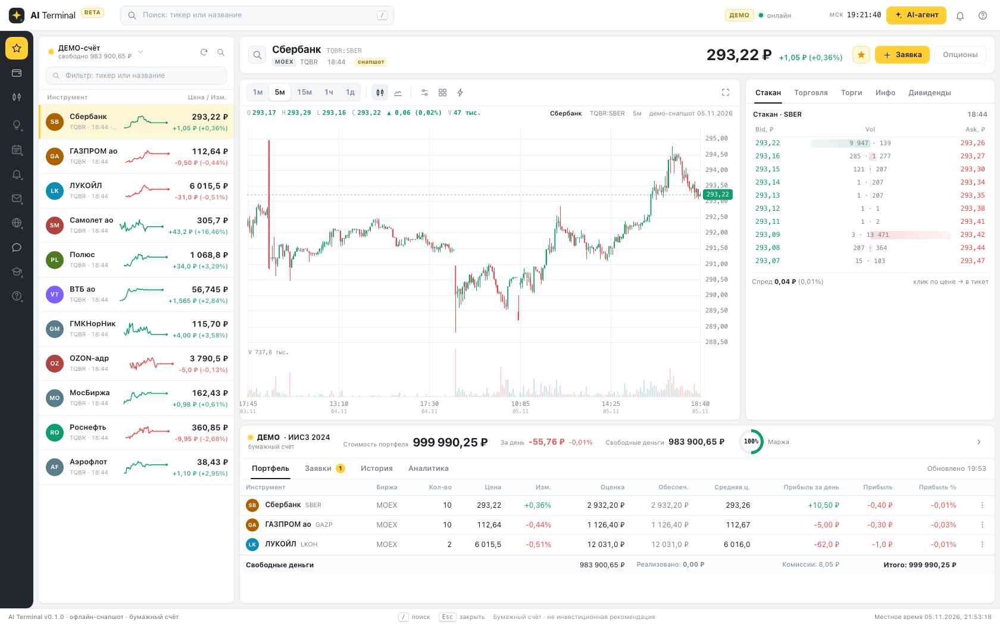

# txmlconnector

Go adapter around the proprietary Win32 `TXmlConnector.dll`. The adapter exposes
the connector over gRPC so native Linux and macOS applications do not depend on
Win32 calls or Wine themselves.


## Нативный клиент (без DLL)

Пакет `native` — типизированный Go-клиент TRANSAQ: без DLL, Wine и XML-слоя. Он
использует тот же протокол, что и Connector, и отдаёт серверные сообщения
Go-структурами; Connector и gRPC-сервер построены поверх него.

```go
ctx, cancel := context.WithTimeout(context.Background(), 5*time.Minute)
defer cancel()

client, err := native.Dial(ctx, native.ClientConfig{
    Address:  "tr1-demo5.finam.ru:3939",
    Login:    os.Getenv("TC_LOGIN"),
    Password: os.Getenv("TC_PASSWORD"),
})
if err != nil {
    log.Fatal(err)
}
defer client.Close()

sber := model.Symbol{Board: "TQBR", SecCode: "SBER"}
if err := client.Subscribe(ctx, native.Subscription{
    AllTrades:  []model.Symbol{sber},
    Quotations: []model.Symbol{sber},
}); err != nil {
    log.Fatal(err)
}
err = client.Run(ctx, native.RunOptions{RqDelay: 100 * time.Millisecond}, func(events []model.Event) error {
    for _, ev := range events {
        switch e := ev.(type) {
        case *model.Trade:
            log.Printf("trade %s %.2f x %d", e.Symbol, e.Price.Float64(), e.Quantity)
        case *model.Quotation:
            log.Printf("quotation %s bid=%s ask=%s", e.Symbol, e.Bid, e.Ask)
        case model.ServerStatus:
            log.Printf("server connected=%v recover=%v", e.Connected, e.Recover)
        }
    }
    return nil
})
```

## AI-терминал (нативный, без DLL) — `bin/terminal`



Терминал можно встроить в интерфейс DeepSeek Harness как основную панель — плагин
[`dsh-ai-terminal`](https://github.com/kmlebedev/dsh-trading-transaq/tree/main/dsh-ai-terminal#readme) добавляет иконку в sidebar и
проксирует терминал под origin Harness (`/ai-terminal/`). **С 2026-11-06 плагин вынесен в отдельный
репозиторий [`kmlebedev/dsh-trading-transaq`](https://github.com/kmlebedev/dsh-trading-transaq)
(каталог `dsh-ai-terminal/`); Go-терминал `bin/terminal` и `cmd/terminal` остаются в этом
репозитории.**

Рынок MOEX для хоста [dsh-trading](https://github.com/zhu1090093659/dsh-trading) подключает коннектор
[`kmlebedev/dshtrading-connector-transaq`](https://github.com/kmlebedev/dshtrading-connector-transaq) (вынесен отсюда 2026-11-09): он читает read-only
шлюз `/api/gw/v1/*` этого терминала ([контракт](docs/ai-terminal/gateway-v1.md)); quick start для
DeepSeek Harness Desktop — в [его QUICKSTART](https://github.com/kmlebedev/dshtrading-connector-transaq/blob/main/dshtrading-connector-transaq/QUICKSTART.md).

`cmd/terminal` — самодостаточный биржевой терминал-аналог Finam поверх `native.Client`:
список инструментов, свечной график, стакан, портфель/заявки, тикет, а также встроенный AI-агент,
который вызывает инструменты терминала (бэктест, декларативные правила, walk-forward с deflated
Sharpe/PBO, оракул волатильности, новости, бумажные заявки) и умеет автономно вести стратегию и
rule-ботов на бумажном счёте. Внешние агенты получают те же инструменты по MCP (`POST /mcp`,
streamable HTTP, токен `X-Terminal-Token`).

```bash
make terminal && ./bin/terminal -mode offline   # http://127.0.0.1:8090, без сети и ключей
```

Офлайн-режим работает на встроенном снапшоте реальных данных демо-сервера TRANSAQ; live-режим
подключается к TranSAQ/Finam через native-клиент (`TRANSAQ_ADDR/TRANSAQ_LOGIN/TRANSAQ_PASSWORD`).
Подробности, скриншоты, LLM-настройка и ограничения — [docs/ai-terminal/README.md](docs/ai-terminal/README.md),
контракты — [docs/ai-terminal/ARCHITECTURE.md](docs/ai-terminal/ARCHITECTURE.md), прогресс фаз —
[docs/ai-terminal/PROGRESS.md](docs/ai-terminal/PROGRESS.md), исследования —
[docs/ai-terminal/research.md](docs/ai-terminal/research.md).

`Run` сам опрашивает RQ_MAIN, восстанавливает соединение после обрыва
(`connected="true" recover="true"`) и отдаёт `model.UnknownRecord`, если
встретил неизвестную запись. Долгий read-only soak (20 валидных бумаг TQBR, Stats/RSS/latency раз в 5 минут) —
`go run ./tools/native-soak` при `TC_SOAK=1`; `TC_SOAK_DURATION` принимает `300` и `300s`; без env он завершается сразу.


## Переносимые навыки AI-терминала (`npx skills add`)

Навыки работы с терминалом лежат в репозитории ([`skills/`](skills/README.md)) и ставятся одной
командой в Cursor, Claude Code, Qwen Code или Codex — без DSH и без MCP:

```bash
npx skills add github.com/kmlebedev/txmlconnector --skill trading-terminal
npx skills add github.com/kmlebedev/txmlconnector --skill trading-pattern-author
npx skills add github.com/kmlebedev/txmlconnector --skill trading-automation-author
```

- `trading-terminal` — котировки, свечи, стакан, бэктест по `rules.Spec`, walk-forward, новости и
  прогноз волатильности через REST (read-only скрипт `skills/trading-terminal/scripts/terminal.sh`)
  или MCP `/mcp` запущенного `bin/terminal`.
- `trading-pattern-author` — как оформить паттерн из исследования: out-of-sample доказательства,
  deflated Sharpe/PBO, promotion policy; паттерны живут вне git.
- `trading-automation-author` — превращение повторяющихся вычислений агента в задачи автоматизации.

Токен терминала (`TERMINAL_API_TOKEN`) и креды TRANSAQ (`TC_LOGIN`/`TC_PASSWORD`) — только в
`.env`, никогда в чате, промпте или коммите; реальные заявки недоступны (paper-only).
В DSH те же навыки отдаёт провайдер плагина `dsh-ai-terminal` из репозитория
[`dsh-trading-transaq`](https://github.com/kmlebedev/dsh-trading-transaq) — один источник, без копий.
Подробнее: [skills/README.md](skills/README.md).

## C ABI библиотека (drop-in для DLL)

`cmd/connector` собирает `libtxmlconnector.so`, `libtxmlconnector.dylib` или
`txmlconnector64.dll` с 9 экспортами оригинальной DLL; клиент подключает её без изменения кода.

```bash
make cabi          # текущая ОС: dylib/so; артефакты и header — в bin/
make cabi-test     # C ABI-тест: 9 экспортов, ошибки, callback, FreeMemory
make cabi-conformance  # C5: сценарии lifecycle/текстов против эталонной DLL (cabi_scenarios.json)
```

Публичный заголовок — [`cmd/connector/include/txmlconnector.h`](cmd/connector/include/txmlconnector.h)
(в `bin/` копируется как `txmlconnector.h`). Релизы под linux amd64/arm64, windows amd64,
macOS arm64/amd64 собирает GitHub Actions workflow
[`.github/workflows/compat-release.yml`](.github/workflows/compat-release.yml): на тег `compat-v*`
публикуется один Release с пятью архивами `txmlconnector-<target>.{tar.gz,zip}` (канонические
библиотеки + header + VERSION.txt + README) и `SHA256SUMS`. Версия drop-in — `6.47.2.26.4`
(override `TXC_VERSION`); точные тексты `InitializeEx`/`GetServiceInfo`/`SetLogLevel` ещё
снимаются с DLL (RE-2), до этого — явные заглушки с TODO.

## Architecture

```text
Linux/macOS/Windows application
        |
        | gRPC (XML command + broadcast XML stream)
        v
server package (platform-neutral lifecycle and transport)
        |
        | connector.Connector
        v
Win32 adapter (windows/amd64 only, pure Go syscall/stdcall)
        |
        v
TXmlConnector.dll
```

The important boundary is the small `connector.Connector` interface:

```go
type Connector interface {
    Start(MessageHandler) error
    SendCommand(context.Context, string) (string, error)
    Close() error
}
```

This keeps the vendor DLL, its memory ownership and Win32 ABI out of gRPC and
business code. It also makes the server testable on Linux/macOS with a fake
adapter. Calls into the DLL are serialized because the vendor documents the
library as not thread-safe. The callback copies the XML and frees DLL-owned
memory before publishing it to buffered subscribers.

The Win32 executable no longer needs CGO or MinGW. On Linux, run that executable
under Wine and keep Linux clients native. A direct Linux wrapper around the DLL
is not possible because the vendor distributes a Win32 binary, not an ELF shared
library.

## Build and test

```shell
go test ./...
go vet ./...
make server_build     # produces bin/server.exe, CGO_ENABLED=0
```

Run the server on Windows:

```powershell
$env:TC_DLL_PATH = "C:\path\to\txmlconnector64-6.47.2.26.4.dll"
$env:TC_LISTEN_ADDR = ":50051"
.\bin\server.exe
```

Run the same adapter on Linux/macOS using Wine:

```shell
export TC_DLL_PATH=/absolute/path/to/txmlconnector64-6.47.2.26.4.dll
make server
```

Or build and run the container:

```shell
make build
docker run --rm -p 50051:50051 kmlebedev/txmlconnector:local server
```

## Deploy to palmshell

The server runs on `palmshell` as a systemd unit under Wine. The deploy targets
build the Windows binary, copy it and the tracked DLL atomically, install the
unit and restart the service:

```bash
make deploy-staging
make deploy-staging-smoke
make deploy-staging-status
make deploy-staging-logs
make rollback-staging
```

Defaults: `/root/bin/txmlconnector-server.exe`,
`/root/txmlconnector64-6.47.2.26.4.dll`, `txmlconnector-server.service`, listen
`:50051`; override with `STAGING_*` variables. See
[deploy/README.md](deploy/README.md).

The server stores no TRANSAQ credentials — the client sends `connect`. The gRPC
endpoint is unauthenticated; for a non-local bind use a VPN or an SSH tunnel
(`ssh -N -L 50051:127.0.0.1:50051 palmshell` with
`STAGING_LISTEN_ADDR=127.0.0.1:50051`).

## Native Go client

The client connects over gRPC and is platform-independent:

```shell
export TC_TARGET=localhost:50051
export TC_LOGIN=...
export TC_PASSWORD=...
export TC_HOST=...
export TC_PORT=...
make client
```

Configuration:

| Variable | Purpose | Default |
| --- | --- | --- |
| `TC_DLL_PATH` | Explicit DLL path | version-derived file name |
| `TC_DLL_VER` | DLL version used in the derived name | `6.43.2.24.0` |
| `TC_DLL_LOG_DIR` | Directory for DLL logs | `logs` |
| `TC_DLL_LOG_LEVEL` | Native DLL log level (`1`-`3`) | `2` |
| `TC_LISTEN_ADDR` | gRPC listen address | `:50051` |
| `TC_SUBSCRIBER_BUFFER` | Per-client XML burst buffer on the server | `8192` |
| `TC_TARGET` | Client gRPC target | `localhost:50051` |
| `TC_LOG_LEVEL` | Go application log level | `info` |

## Portfolio updates

`NewTCClientWithOptions` can expose a race-safe stream of portfolio messages.
The zero `Options` keeps the environment-based behaviour; `PortfolioBuffer > 0`
enables the stream. `PortfolioUpdates` is closed when the response stream ends.

```go
client, err := tcClient.NewTCClientWithOptions(tcClient.Options{
    Target:          os.Getenv("TC_TARGET"),
    PortfolioBuffer: 64,
    Connect: &tcClient.ConnectConfig{
        Login:    os.Getenv("TC_LOGIN"),
        Password: os.Getenv("TC_PASSWORD"),
        Host:     os.Getenv("TC_HOST"),
        Port:     os.Getenv("TC_PORT"),
    },
})
if err != nil {
    return err
}
defer client.Close()

for update := range client.PortfolioUpdates() {
    // update.Kind is client, securities, positions, united_portfolio or
    // united_limits; Raw keeps the original XML.
    _ = update
}
```

`TCClient.Data` remains for source compatibility but is written by the stream
dispatcher without synchronization. New code must consume the typed channels.
Use `RunWithReconnect` to recreate the client after a stream failure.

## Compatibility notes

- The protobuf service and existing Go client fields remain compatible.
- `server.TxmlSendCommand`, `server.Messages` and `server.Done` remain available
  on `windows/amd64` as deprecated migration shims. New code should depend on
  `connector.Connector` explicitly.
- Every gRPC stream receives its own copy of each XML message. Slow subscribers
  are disconnected with `ResourceExhausted` rather than blocking the vendor
  callback and all other clients.
- The Go client reads the gRPC stream into an internal FIFO before decoding XML.
  This keeps application handlers and temporary database stalls from blocking
  transport reads while preserving message order.

## References

- [TRANSAQ XML Connector documentation](https://files.comon.ru/usercontent/TXmlConnector.pdf)
- [gRPC](https://grpc.io/)
