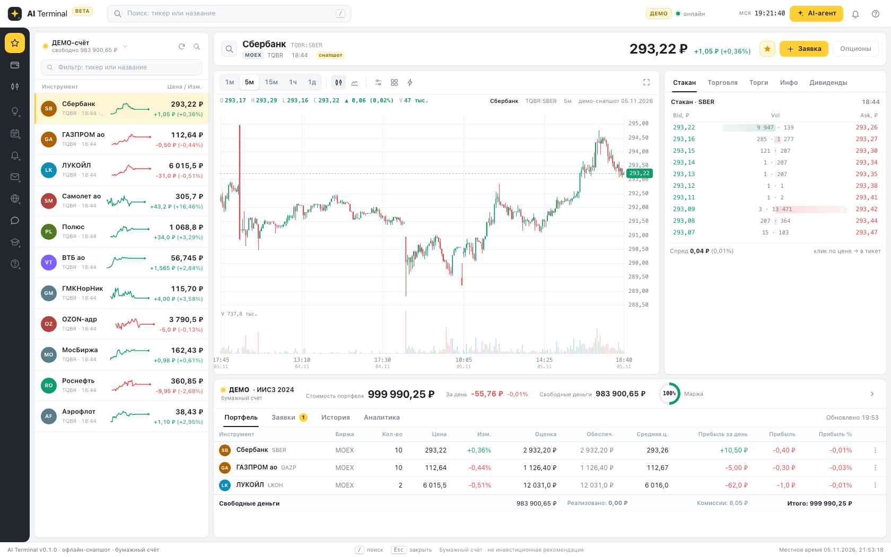

# AI Terminal — DSH plugin

Встраивает нативный AI-терминал (MOEX/TRANSAQ, `cmd/terminal`) в интерфейс
DeepSeek Harness как **основную панель** с иконкой в левой панели Harness.



## Что делает

- добавляет в sidebar Harness иконку **AI-терминал**; клик открывает main panel
  с полноценным терминалом (график, стакан, портфель, заявки, AI-агент,
  автономные стратегии);
- Host-половина плагина запускает Go-бэкенд терминала (по умолчанию
  `bin/terminal` этого checkout'а, при отсутствии — собирает `go build`),
  ждёт `/api/health` и **проксирует** SPA и API под тем же origin, что и
  Harness: `/ai-terminal/` (REST + SSE, без CORS и второго порта в браузере);
- панель в стиле Harness (тема `--dsw-alias-*`, локали en/ru/zh) показывает
  статус бэкенда, кнопки «Обновить», «Перезапустить», «Открыть в браузере»;
- при выгрузке плагина/остановке Harness дочерний бэкенд завершается.

## Требования

- профиль DSH с Web UI (плагин использует Client slots `main` и
  `sidebar.panellist`);
- Go 1.27+ (если `bin/terminal` отсутствует и его нужно собрать) или заранее
  собранный `bin/terminal` (`make terminal`).

## Установка

Плагин ставится как локальный bundle:

```bash
# из корня checkout'а txmlconnector
make terminal                      # bin/terminal
# затем в DSH-сессии: plugin_manager install_bundle с target = <repo>/dsh-ai-terminal
```

Или вручную в профиль (не рекомендуется — используйте plugin_manager):

```yaml
- insert:
    - id: ai-terminal
      name: '@local/dsh-ai-terminal'
      config: { mode: offline, port: 18090, autoStart: true }
```

## Конфигурация (row `ai-terminal`)

| Ключ | По умолчанию | Смысл |
|---|---|---|
| `mode` | `offline` | `offline` — встроенный снапшот демо-данных; `live` — живой read-only TRANSAQ (нужны env `TRANSAQ_*`/`TC_*` в окружении запуска Harness); `auto` |
| `port` | `18090` | loopback-порт Go-бэкенда; наружу не публикуется |
| `autoStart` | `true` | запускать бэкенд при загрузке плагина |
| `repoDir` | авто | checkout с `cmd/terminal` (по умолчанию — родитель каталога плагина) |
| `binaryPath` | авто | заранее собранный бэкенд; по умолчанию `<repoDir>/bin/terminal` |

## Ограничения и безопасность

- Бэкенд слушает только `127.0.0.1`; доступ к панели — в рамках
  аутентифицированной сессии Harness. Отдельного порта в браузере нет:
  всё идёт через `/ai-terminal/` origin Harness.
- Реальные ордера в терминале выключены (paper-only; live-режим read-only).
- После изменения `terminal/web/**` пересоберите `bin/terminal`
  (`make terminal`) — Go embed вшивает SPA в бинарь.
- Если в конфиге `live`, а env-креды не заданы, бэкенд завершится; статус
  панели покажет причину, кнопка «Перезапустить» перезапустит его после
  исправления окружения.

## Проверено

- Host-половина протестирована локальным harness'ом: реальный HTTP-сервер с
  зарегистрированными роутами + настоящий Go-бэкенд; проверены index/assets,
  REST (GET/POST), SSE-стрим, restart, lifecycle (бэкенд завершается при
  dispose).
- Client-половина: синтаксис, регистрация slots `main`/`sidebar.panellist`
  через `cordis_inspect_query` после установки.
